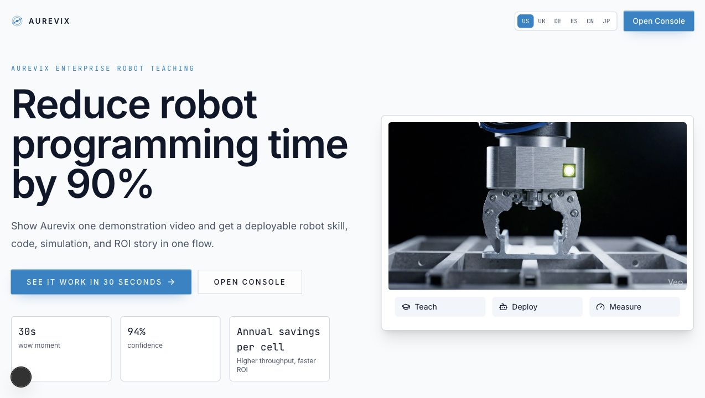
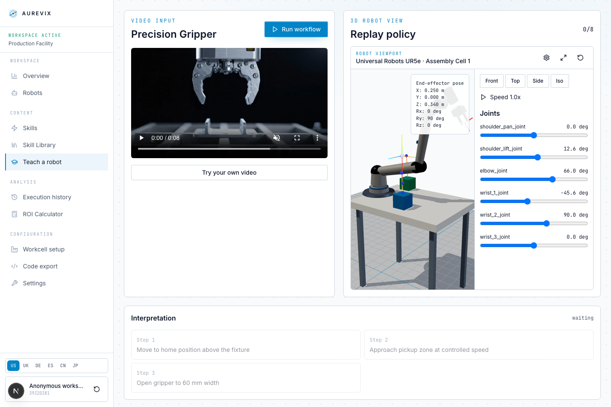
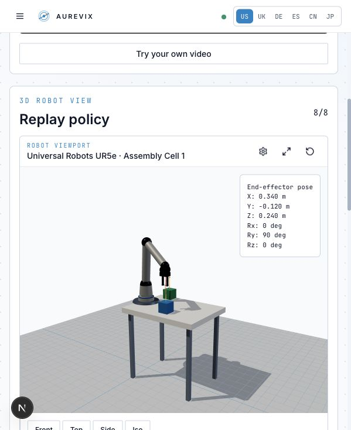
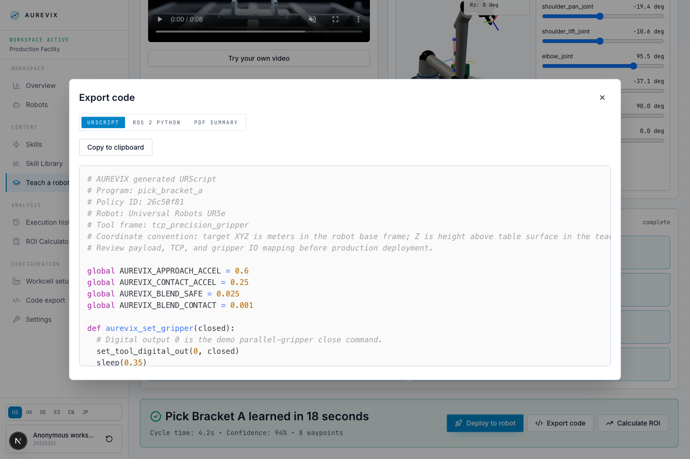
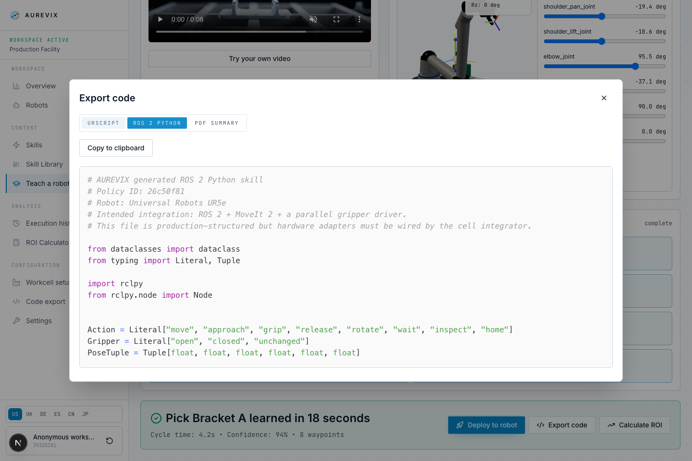
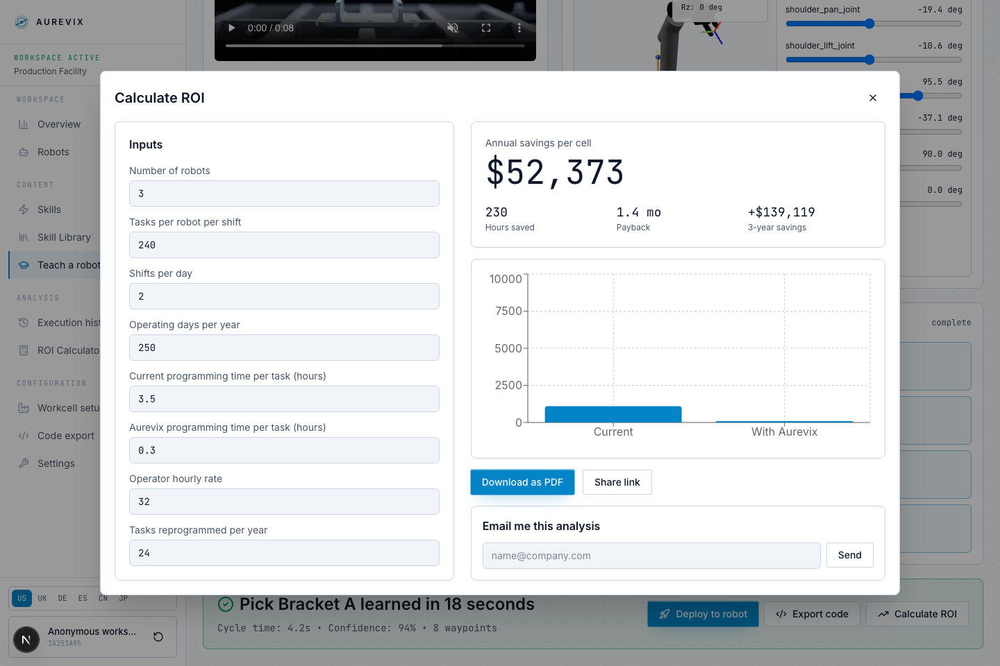
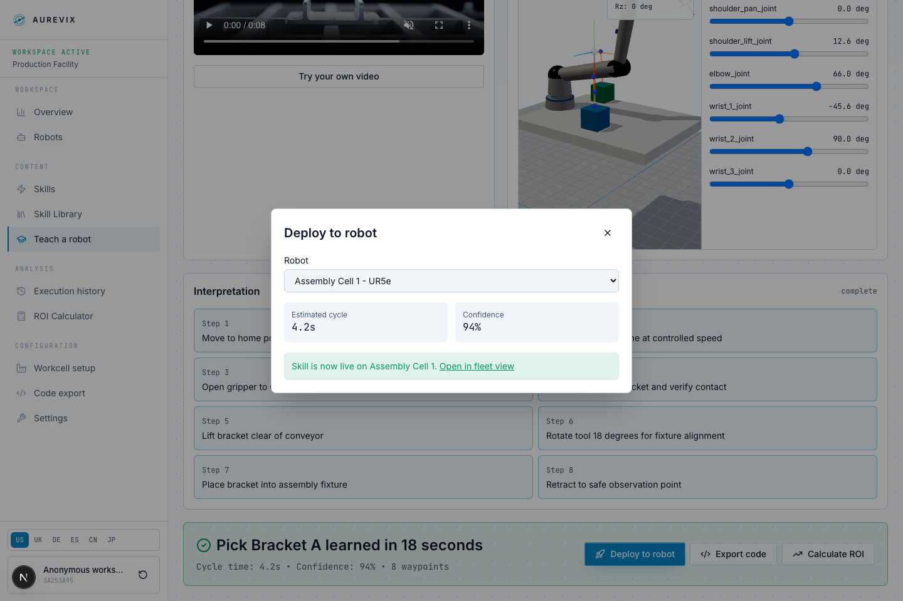

# Aurevix Workflow Notes for AI Agents

This document captures the validated local workflow for Aurevix, the AI-powered robot teaching platform in this repository.

## Local App

- Start from the repo root: `pnpm --filter @forge-mind/web-v3 dev`
- Open: `http://localhost:3000`
- Primary workflow page: `http://localhost:3000/app/teach`
- Optional AI service: Ollama at `http://localhost:11434`
- The validated browser demo path uses deterministic fallback steps, so it can run without Ollama.

## Validated Demo Flow

The validated operator path is:

1. Open the landing page.
2. Enter the console through `Open Console` or go directly to `/app/teach`.
3. On `Teach a robot`, review the `Precision Gripper` video input and the UR5e replay viewport.
4. Click `Run workflow`.
5. The interpretation panel streams eight discrete steps:
   - Move to home position above the fixture
   - Approach pickup zone at controlled speed
   - Open gripper to 60 mm width
   - Close gripper on bracket and verify contact
   - Lift bracket clear of conveyor
   - Rotate tool 18 degrees for fixture alignment
   - Place bracket into assembly fixture
   - Retract to safe observation point
6. The result panel appears: `Pick Bracket A learned in 18 seconds`.
7. From the result panel, validate the operator actions:
   - `Deploy to robot` opens a robot selection modal and can mark the skill live on Assembly Cell 1.
   - `Export code` opens URScript, ROS 2 Python, and PDF Summary tabs.
   - `Calculate ROI` opens the ROI calculator with editable inputs and savings/payback outputs.

## Verified Outcome

Validated in Chromium on May 23, 2026:

- Landing page loads.
- App shell and sidebar load.
- Teach workflow completes from `Run workflow` to final result panel.
- 3D robot viewport renders a table-mounted UR5e on a visible mount plate, with the work table surface at world Y=0.75m and policy Z values interpreted as height above the table.
- The viewport updates end-effector pose, joint telemetry, waypoint markers, and trajectory playback.
- No collision warning is visible after the table/workcell coordinate fix.
- Export modal renders production-structured URScript and exposes ROS 2 Python and PDF tabs.
- URScript includes policy provenance, safety constants, TCP setup, gripper helper, guarded motion helper, per-step comments, and verification checkpoints.
- ROS 2 Python includes typed step data, a node class, motion/gripper adapter hooks, execution dispatch, and integration TODOs for MoveIt 2/gripper wiring.
- Modals close with Escape, backdrop click, or the close button.
- ROI modal renders inputs, annual savings, hours saved, payback, 3-year savings, and sharing actions.
- ROI US defaults render with period decimals: `3.5`, `0.3`, `$52,373`, `1.4 mo`, `+$139,119`.
- ROI German defaults render with comma decimals: `3,5`, `0,3`, and euro currency formatting.
- Deploy modal renders robot selection, estimated cycle, confidence, and success state.
- Browser validation found no page errors and no relevant failed requests.
- Production build passes.
- Typecheck passes when run after build generation is complete.

## Screenshots

Screenshots are stored under `docs/workflow-screenshots/`.

## Notes for Future Agents

- The main user-facing MVP is `apps/web`.
- Read `apps/web/src/lib/types.ts` before changing data shapes.
- The demo teaching surface is `apps/web/src/app/app/teach/page.tsx`.
- The 3D replay surface is `apps/web/src/components/robot-viewport.tsx`.
- Demo seed data lives in `apps/web/src/lib/demo-seed.ts`.
- Avoid running `pnpm build` while `pnpm dev` is active; both use `.next`, and concurrent use can leave the dev server looking at missing generated files. Restart `pnpm dev` after a production build.
- `pnpm typecheck` includes `.next/types`, so run `pnpm build` once first in a clean checkout if those generated type files do not exist yet.

## Browser Validation Script Summary

The latest validation used Playwright Chromium against `http://localhost:3000/app/teach?locale=en-US`.

Validated path:

1. Load teach page and wait for the procedural UR5e viewport to settle.
2. Save `02-teach-start.png`.
3. Click `Run workflow`.
4. Wait for `Pick Bracket A learned in 18 seconds`.
5. Confirm `8/8`, result panel visible, and collision warning count is `0`.
6. Save `03-workflow-complete.png`.
7. Open `Export code`, confirm URScript content, save `04-export-code.png`, close with Escape.
8. Open `Calculate ROI`, confirm ROI outputs, save `05-roi-modal.png`, close with Escape.
9. Open `Deploy to robot`, click `Deploy`, confirm live success message, save `06-deploy-success.png`.
10. Open `/app/roi`, verify US and German locale formatting.

Observed validation values:

- Collision warnings after workflow: `0`
- Professional URScript checks: `Policy ID`, `aurevix_guarded_movel`, and deployment review comments present
- Professional ROS 2 checks: typed dataclass steps, `PickBracketASkill`, and `execute_step` dispatch present
- US ROI inputs: `3`, `240`, `2`, `250`, `3.5`, `0.3`, `32`, `24`
- DE ROI inputs: `3`, `240`, `2`, `250`, `3,5`, `0,3`, `28`, `24`
- Serious console/page errors: none
- Relevant failed network requests: none
